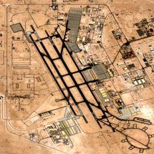
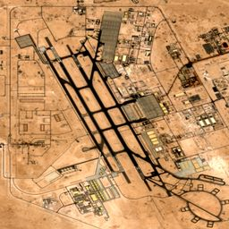
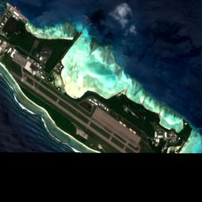
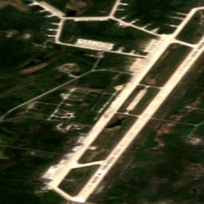

# Base watch feasibility test: result

Written by `warwatch/basespike.py` on 2026-10-15 to the plan fixed before it ran ([BASESPIKE_PLAN.md](BASESPIKE_PLAN.md)).

**Verdict: NO-GO.** 2 of 3 leading cases caught; the chosen radar pair is `blobs` at VV ≥ -3 dB, with a false-alarm rate of 10% on the other scenes (the rule needs at least 2 cases and 10% or less).

## Radar pairs (Sentinel-1, Al Udeid, Bahrain and Olenya)

| Metric | VV threshold | Leading cases caught (of 2 radar) | False-alarm rate | Other scenes |
|---|---:|---:|---:|---:|
| bright_m2 | -6 dB | 1 | 19% | 145 |
| bright_m2 | -3 dB | 1 | 24% | 145 |
| bright_m2 | 0 dB | 0 | 23% | 145 |
| bright_m2 | 3 dB | 0 | 24% | 145 |
| blobs | -6 dB | 1 | 12% | 145 |
| blobs | -3 dB | 2 | 10% | 145 |
| blobs | 0 dB | 1 | 12% | 145 |
| blobs | 3 dB | 1 | 8% | 145 |

## Each case with the chosen radar pair

### al_udeid: aircraft dispersed before Iran's strike of 23 Jun 2025 (2025-06-19)

Radar scenes: 37. Caught: yes, 2025-06-16 (z -2.7), 2025-06-19 (z -2.7).

| Date | Orbit | Value | z |
|---|---|---:|---:|
| 2025-05-23 | A101 | 28 | -0.7 |
| 2025-05-26 | D137 | 57 | +0.8 |
| 2025-06-04 | A101 | 31 | +0.3 |
| 2025-06-07 | D137 | 48 | -0.7 |
| 2025-06-16 | A101 | 22 | -2.7 |
| 2025-06-19 | D137 | 36 | -2.7 |
| 2025-06-28 | A101 | 29 | -0.3 |
| 2025-07-01 | D137 | 53 | +0.2 |
| 2025-07-10 | A101 | 36 | +2.0 |
| 2025-07-13 | D137 | 65 | +2.2 |

Optical (Sentinel-2, clear scenes): 37 scenes. Caught: no.

| Date | Object pixels | z |
|---|---:|---:|
| 2025-05-20 | 4281 | -2.3 |
| 2025-05-23 | 4462 | -1.5 |
| 2025-05-28 | 4469 | -1.1 |
| 2025-06-02 | 4825 | -0.1 |
| 2025-06-07 | 4973 | +0.4 |
| 2025-06-09 | 4410 | -1.0 |
| 2025-06-12 | 4451 | -0.9 |
| 2025-06-17 | 4111 | -1.5 |
| 2025-06-22 | 5402 | +1.2 |
| 2025-06-27 | 4570 | -0.5 |
| 2025-07-07 | 3885 | -2.2 |

 

Contains modified Copernicus Sentinel data 2024–2026.

### nsa_bahrain: US ships left port before the strikes of 28 Feb 2026 (2026-02-26)

Radar scenes: 80. Caught: yes, 2026-03-04 (z -4.0).

| Date | Orbit | Value | z |
|---|---|---:|---:|
| 2026-01-27 | D137 | 8 | +0.0 |
| 2026-01-30 | A101 | 9 | -0.2 |
| 2026-02-02 | D137 | 7 | -0.7 |
| 2026-02-08 | D137 | 5 | -2.0 |
| 2026-02-11 | A101 | 8 | -0.7 |
| 2026-02-14 | D137 | 4 | -2.7 |
| 2026-02-17 | A101 | 8 | -0.4 |
| 2026-02-20 | D137 | 8 | +0.5 |
| 2026-02-23 | A101 | 10 | +0.4 |
| 2026-03-01 | A101 | 6 | -2.0 |
| 2026-03-04 | D137 | 2 | -4.0 |
| 2026-03-07 | A101 | 10 | +0.7 |
| 2026-03-10 | D137 | 4 | -3.5 |
| 2026-03-13 | A101 | 9 | +0.0 |

Optical (Sentinel-2, clear scenes): 0 scenes. Caught: no.

### diego_garcia: B-2 bombers deployed (reported from late March 2025) (2025-03-25)

No Sentinel-1 coverage at this site: optical only.

Optical (Sentinel-2, clear scenes): 6 scenes. Caught: no.

| Date | Object pixels | z |
|---|---:|---:|
| 2025-03-31 | 617 |  |
| 2025-03-31 | 661 |  |
| 2025-04-10 | 640 |  |
| 2025-04-10 | 707 |  |
| 2025-04-10 | 681 |  |

 

Contains modified Copernicus Sentinel data 2024–2026.

### olenya: bombers present, then struck on 1 Jun 2025 (2025-06-01)

Radar scenes: 116. Caught: yes, 2025-05-29 (z -2.7).

| Date | Orbit | Value | z |
|---|---|---:|---:|
| 2025-05-02 | A145 | 1 | +0.0 |
| 2025-05-03 | A72 | 2 | +1.0 |
| 2025-05-04 | D80 | 9 | -0.2 |
| 2025-05-05 | D7 | 11 | +4.0 |
| 2025-05-06 | D109 | 4 |  |
| 2025-05-08 | A145 | 1 | +0.0 |
| 2025-05-09 | A72 | 1 | +0.0 |
| 2025-05-10 | D80 | 1 | -5.4 |
| 2025-05-11 | D7 | 3 | -1.3 |
| 2025-05-14 | A145 | 1 | +0.0 |
| 2025-05-15 | A72 | 2 | +1.0 |
| 2025-05-16 | D80 | 10 | +0.7 |
| 2025-05-17 | D7 | 1 | -2.7 |
| 2025-05-18 | D109 | 7 |  |
| 2025-05-20 | A145 | 1 | +0.0 |
| 2025-05-21 | A72 | 1 | +0.0 |
| 2025-05-22 | D80 | 1 | -5.4 |
| 2025-05-23 | D7 | 5 | +0.0 |
| 2025-05-26 | A145 | 1 | +0.0 |
| 2025-05-27 | A72 | 2 | +1.0 |
| 2025-05-28 | D80 | 12 | +2.0 |
| 2025-05-29 | D7 | 1 | -2.7 |
| 2025-05-30 | D109 | 7 |  |
| 2025-06-01 | A145 | 2 | +1.0 |
| 2025-06-02 | A72 | 1 | +0.0 |
| 2025-06-03 | D80 | 5 | -2.0 |
| 2025-06-04 | D7 | 4 | -0.7 |
| 2025-06-07 | A145 | 1 | +0.0 |
| 2025-06-08 | A72 | 0 | -1.0 |
| 2025-06-09 | D80 | 10 | +0.2 |
| 2025-06-10 | D7 | 6 | +0.7 |
| 2025-06-11 | D109 | 4 |  |
| 2025-06-13 | A145 | 0 | -1.0 |
| 2025-06-15 | D80 | 8 | -0.9 |
| 2025-06-16 | D7 | 2 | -2.0 |
| 2025-06-19 | A145 | 1 | +0.0 |
| 2025-06-20 | A72 | 3 | +2.0 |
| 2025-06-21 | D80 | 12 | +0.9 |
| 2025-06-22 | D7 | 4 | -0.7 |
| 2025-06-23 | D109 | 5 |  |
| 2025-06-25 | A145 | 1 | +0.0 |
| 2025-06-26 | A72 | 0 | -1.0 |
| 2025-06-27 | D80 | 7 | -1.3 |
| 2025-06-28 | D7 | 3 | -1.3 |

Optical (Sentinel-2, clear scenes): 22 scenes. Caught: yes, 2025-06-05 (z -4.2), 2025-06-07 (z -3.2).

| Date | Object pixels | z |
|---|---:|---:|
| 2025-05-10 | 915 | -1.5 |
| 2025-05-11 | 635 | -2.8 |
| 2025-05-13 | 346 | -4.3 |
| 2025-05-23 | 216 | -4.9 |
| 2025-06-05 | 356 | -4.2 |
| 2025-06-07 | 363 | -3.2 |
| 2025-06-07 | 382 | -2.4 |
| 2025-06-11 | 375 | -2.1 |
| 2025-06-14 | 550 | -1.1 |

 

Contains modified Copernicus Sentinel data 2024–2026.

## Optical false-alarm rate (Diego Garcia)

n/a of the other clear scenes reached |z| ≥ 2.5.

## Reading the result (written after the verdict; it does not change it)

- **The verdict is NO-GO by a hair.** The best pair caught 2 of 3 leading cases, as the rule needs. Its false-alarm rate
  was 15 of 145 other scenes (10.3%) against a limit of 10%.
- **Al Udeid would have been flagged on 19 June 2025.** Two consecutive passes from different orbits (16 and 19 June) both
  fell to z −2.7: far fewer bright objects on the aprons than usual. The monitor's own rule, two passes within a week
  beyond 2.5, would have put the base in "out" four days before Iran struck it.
- **Bahrain** dropped to z −4.0 on 4 March 2026. That is after the strikes of 28 February, so it is not a warning.
- **Olenya**: radar fell to −2.7 on 29 May, three days before the strike. The optical object count fell to −4.2 after it
  (damage).
- **Diego Garcia** had only 6 clear optical scenes from December to May, too few to score (8 are needed). Cloud is the
  limit there.
- The false-alarm rate here counts **single scenes**. The monitor only raises "out" or "in" when **two** passes agree,
  which should cut false alarms sharply. That rule was not what this test measured, so it is not credited here.

**What happens now.** NO-GO is applied as the plan says. `basewatch.ALERTS` stays `False`. The base layer is an image
viewer: a neutral marker, the latest radar z as text, chips, and links. There are no alerts, no `bases_out`/`bases_in`
series, and the "bases" tell is back to "not watched".

**Suggested next test (not run; it needs its own plan, fixed before reading).** Score the two-pass state (the rule the
monitor uses) over a backfill from 2022 on all 30 sites, against the events and calm windows of
[BASEWATCH_STUDY_PLAN.md](BASEWATCH_STUDY_PLAN.md). Freeze `blobs` at −3 dB from this test before the backfill is read.
Use calm-window firing as the false-alarm measure.
